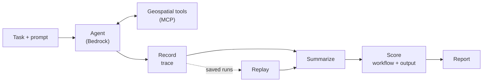
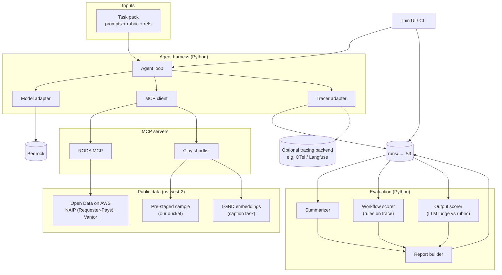
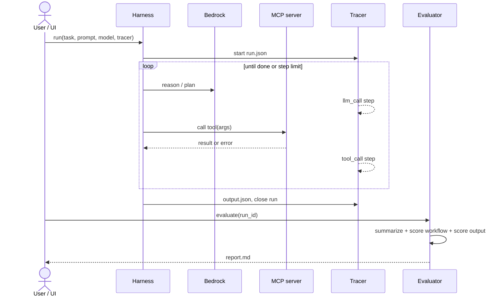
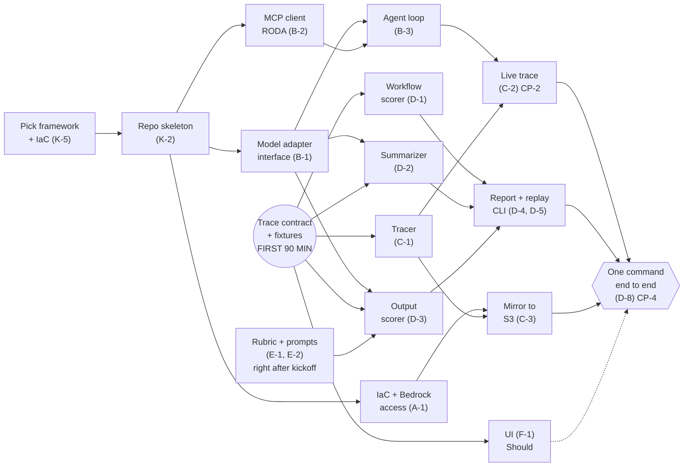
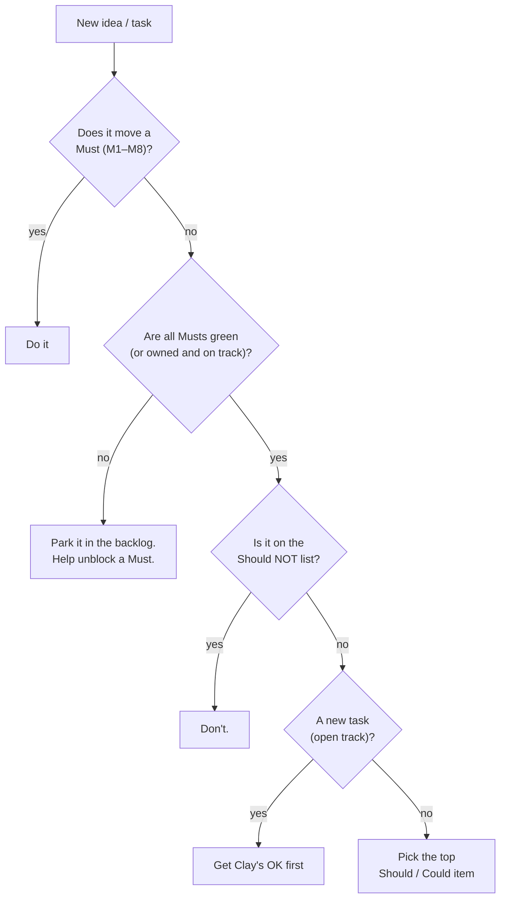

# Visuals

Put these on the screen at kickoff and come back to them at every checkpoint.

## 1. The loop (what we're building)

**Observe → summarize → score.** Everything we build sits on one of these arrows.

## 2. Architecture and swap points

- The **adapters** (model and tracer) are where M6 "swappable" lives.
- The summarizer and output scorer also call Bedrock **through the model adapter**.
- If Clay supplies the harness under test, it replaces the "Agent harness" box. Everything below `runs/` stays the same.
- `runs/` is the contract boundary; see [trace-contract.md](trace-contract.md).
- Which tool reaches which data is illustrative. RODA does discovery and sampling of Open Data on AWS; the Clay shortlist is unknown until kickoff.

## 3. One run, step by step

Replay is the same thing with the top half skipped: `evaluate(run_id)` on a saved run.

## 4. Who can work on what, and when

What blocks others, all of it small and early:

- **The contract and fixtures** (the first ~90 minutes, everyone). They unblock the tracer, all the scorers and the UI.
- **Picking the framework and IaC, then the repo skeleton.** These unblock the AWS setup, the model adapter and the MCP client.
- **The model adapter interface.** The agent, the summarizer and the judge all call the LLM through it.

Nothing waits on Clay's answers: the rubric work starts right after kickoff with a stand-in. Everyone builds in their own sandbox until the shared one is up. The UI is a Should, so the end-to-end milestone doesn't wait for it.

## 5. Timeline

The docs call this a **2-day build** but give no schedule. These times are assumed; adjust them at kickoff to the real agenda.

```mermaid
gantt
    title Day 1 — get one trace through the whole loop
    dateFormat HH:mm
    axisFormat %H:%M
    section Everyone
    Kickoff, confirm unknowns with Clay      :crit, k, 09:00, 45m
    Ratify trace contract + fixtures         :crit, c, after k, 45m
    Pick framework + repo skeleton (K-5, K-2) :rs, after k, 45m
    Checkpoint (CP-1)                        :milestone, after c, 0m
    section Build
    IaC + Bedrock access (A-1)               :i, after rs, 2h
    Mirror to S3 + stage data (C-3, A-2)     :i2, after i, 2h
    Harness + RODA MCP (B-1..B-3)            :h, after rs, 210m
    Wire tracer into harness (C-2)           :cw, after h, 30m
    Tracer adapter (C-1)                     :t, after c, 3h
    Summarizer on fixtures (D-2)             :s, after c, 3h
    Workflow scorer on fixtures (D-1)        :w, after c, 3h
    Rubric + synthetic prompts (E-1, E-2)    :r, after k, 2h
    Output scorer, LLM judge (D-3)           :o, after r, 3h
    Report + replay CLI (D-4, D-5)           :rp, after o, 90m
    section Integrate
    First live trace captured (CP-2)         :milestone, 14:30, 0m
    Report from fixture (CP-3)               :milestone, 16:30, 0m
    Stand-up + re-plan                       :crit, 17:00, 30m
```

```mermaid
gantt
    title Day 2 — make it real, make it reliable, show it
    dateFormat HH:mm
    axisFormat %H:%M
    section Must
    One command end to end, D-8 (CP-4)        :crit, d, 09:00, 3h
    Swap model + tracer (B-4, C-4)           :sw, 09:00, 2h
    Record golden runs for replay            :g, after d, 1h
    Deploy from clean checkout (A-4)         :dc, 11:00, 3h
    section Should / Could
    Thin UI wired to runs                    :u, 09:00, 4h
    Second task OR sensitivity analysis      :x, 11:00, 3h
    section Ship
    Feature freeze (CP-5)                     :milestone, 14:00, 0m
    README polish (G-2)                      :doc, 14:00, 90m
    Demo rehearsal x2                        :crit, demo, 15:30, 1h
```

## 6. Checkpoint board (are we on track?)

| Milestone | When (assumed) | Done when | ✅ |
|-----------|----------------|-----------|----|
| **CP-1** Contract ratified | D1 ~10:30 | `trace-contract.md` agreed; 3 fixture runs committed | ☐ |
| **CP-2** First live trace | D1 ~14:30 | Agent calls RODA via MCP on Bedrock; `trace.jsonl` written | ☐ |
| **CP-3** First report | D1 ~16:30 | `report.md` generated for a fixture, with the summary and both scores (D-4) | ☐ |
| **CP-4** Live end to end | D2 ~12:00 | One command (D-8): live run → report, saved to S3 | ☐ |
| **CP-5** Freeze | D2 ~14:00 | Model **and** tracer swap demos work; the replay demo works; deploy from a clean checkout works; the repo is public (G-4) | ☐ |

**Rule:** if a milestone slips by more than an hour, cut the Could items first, then the Should items (the UI), before touching any Must.

## 7. "Should I work on this?"

